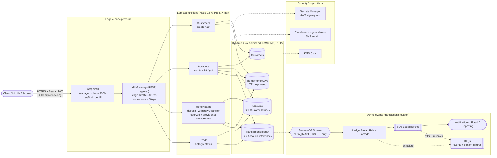
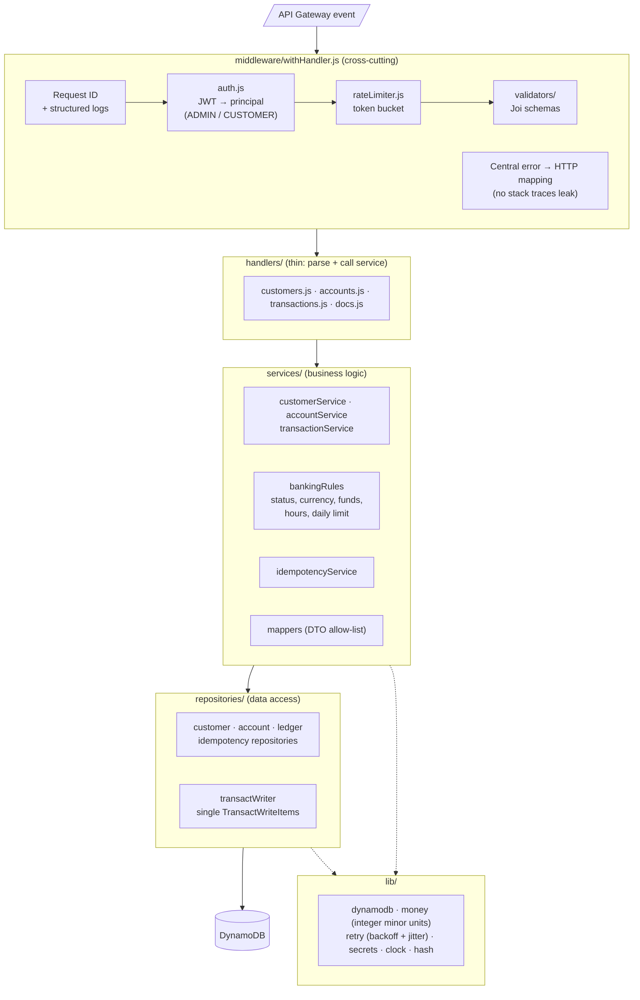
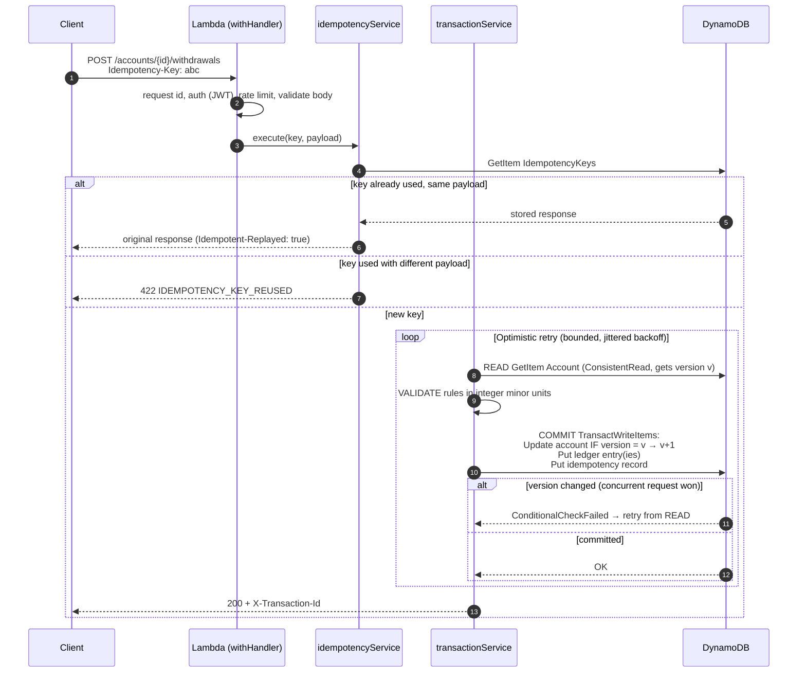
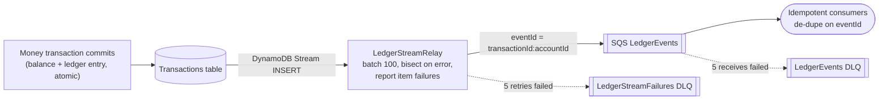

# Architecture

Serverless banking API on AWS: **API Gateway → Lambda (Node.js) → DynamoDB**, with a DynamoDB Streams
outbox that publishes ledger events to SQS. Infrastructure is AWS CDK ([infra/lib/banking-stack.js](../infra/lib/banking-stack.js));
local development uses `serverless-offline` + DynamoDB Local ([serverless.yml](../serverless.yml), [docker-compose.yml](../docker-compose.yml)).

Data model: see [ER_DIAGRAM.md](ER_DIAGRAM.md).

---

## 1. System architecture (AWS deployment)

Each function gets **least-privilege IAM**: only the exact DynamoDB actions on the exact tables it uses
(e.g. `getCustomer` can only `GetItem` on `Customers`).

---

## 2. Code architecture (layers inside one Lambda)

**Why this split:** handlers know HTTP, services know banking, repositories know DynamoDB. Business rules
are pure functions, so they are unit-tested without a database.

---

## 3. Request flow: a money movement (withdraw / transfer)

---

## 4. Event flow: transactional outbox

The API never does "write DB, then publish to SQS" (a **dual write** that can half-fail). It writes only to
DynamoDB; the ledger entry *is* the event, and the stream relays it. Delivery is at-least-once, so consumers
de-duplicate.
