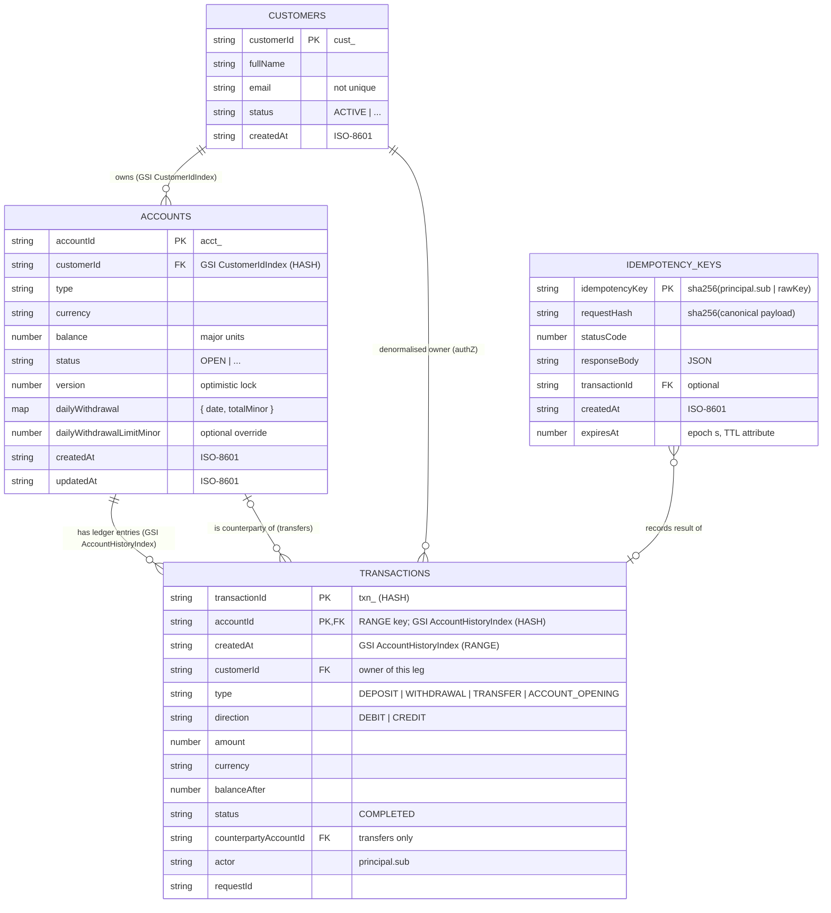

# Entity-Relationship Diagram

Data model for the Banking API (DynamoDB). Source of truth: [scripts/create-tables.js](../scripts/create-tables.js),
[src/repositories/](../src/repositories/) and the services that build the items.

DynamoDB does not enforce foreign keys. The relationships below are **logical**: they are kept consistent by
the application, mostly by writing related items in a single `TransactWriteItems` call
([transactWriter.js](../src/repositories/transactWriter.js)).

## Tables and keys

| Table | Partition key | Sort key | Secondary index | Notes |
|---|---|---|---|---|
| `Customers` | `customerId` | — | — | Created by ADMIN only |
| `Accounts` | `accountId` | — | `CustomerIdIndex` (`customerId`) | Versioned updates (optimistic locking) |
| `Transactions` | `transactionId` | `accountId` | `AccountHistoryIndex` (`accountId`, `createdAt`) | Append-only ledger; Streams `NEW_IMAGE` → [ledgerStream.js](../src/handlers/ledgerStream.js) → SQS |
| `IdempotencyKeys` | `idempotencyKey` | — | — | TTL on `expiresAt` |

## Relationship notes

- **Customer → Account (1 : 0..N)**: `Accounts.customerId`. An account can only be opened while the customer is
  `ACTIVE`, checked atomically by a `ConditionCheck` in the same transaction.
- **Account → Ledger entry (1 : 0..N)**: `Transactions.accountId`. Deposits, withdrawals and account openings
  write one item; a transfer writes **two items with the same `transactionId`** (a DEBIT leg and a CREDIT leg),
  which is why the table key is `(transactionId, accountId)`.
- **Counterparty (0..1)**: transfer legs carry `counterpartyAccountId`, pointing to the other account.
- **Customer on ledger entries**: `customerId` is copied onto each leg so a customer can look up a transaction
  without reading the account.
- **Idempotency record → Transaction (0..1)**: stores the original response (and `transactionId` for money
  movements) so a retried request is replayed instead of executed twice. It is committed in the same
  transaction as the money movement.
